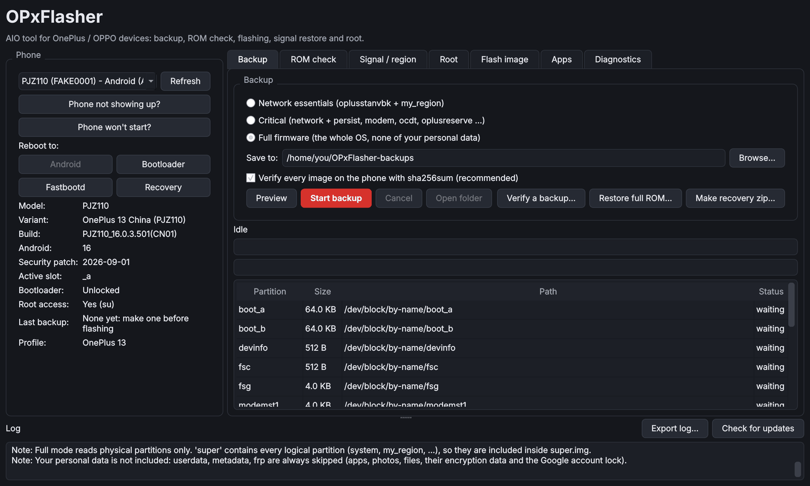
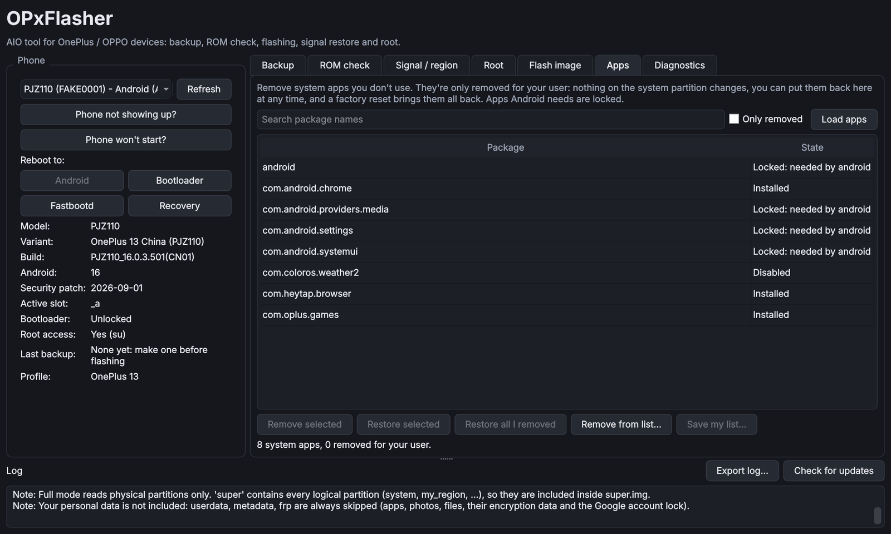
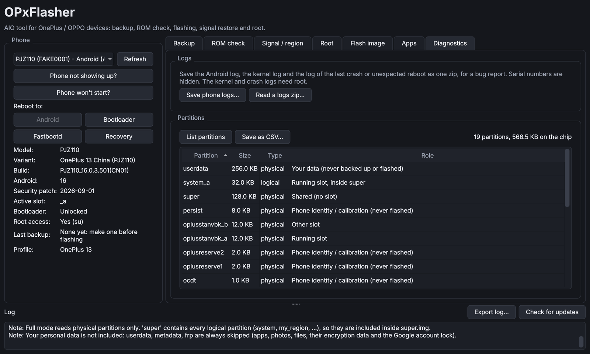

<h1 align="center">
  <picture>
    <source media="(prefers-color-scheme: dark)" srcset="assets/brand/wordmark-on-dark.svg">
    
  </picture>
</h1>

<p align="center">
  <b>AIO tool for OnePlus / OPPO devices</b><br>
  Back up, check, flash, restore and rescue your phone, with checks that stop a bad flash before it starts.
</p>

<p align="center">
  <a href="https://github.com/ox1d3x3/OPxFlasher/releases"></a>
  <a href="https://github.com/ox1d3x3/OPxFlasher/releases"></a>
  <a href="https://github.com/ox1d3x3/OPxFlasher/releases"></a>
  <a href="https://github.com/ox1d3x3/OPxFlasher/actions/workflows/ci.yml"></a>
  <a href="https://github.com/ox1d3x3/OPxFlasher/actions/workflows/build.yml"></a>
  <br>
  
  
  <a href="#verify-your-download"></a>
  <a href="LICENSE"></a>
</p>

<p align="center">
  <a href="#download"><b>Download</b></a> ·
  <a href="docs/USER_GUIDE.md"><b>User guide</b></a> ·
  <a href="docs/CLI.md"><b>Command line</b></a> ·
  <a href="#supported-phones"><b>Supported phones</b></a> ·
  <a href="https://github.com/ox1d3x3/OPxFlasher/issues"><b>Report a problem</b></a>
</p>

<p align="center">
  
</p>

---

## Why OPxFlasher

Flashing a OnePlus or OPPO phone usually means a folder of scripts, a ROM you hope is the
right one, and no way back if it isn't. OPxFlasher puts every step in one app, from backup
and ROM checks to flashing and recovery. Before anything is written, it checks that the
firmware fits **your** phone and that you have a verified backup to return to.

- **Fail closed.** If a check can't confirm something is safe, OPxFlasher stops and tells you why.
- **Your data stays yours.** `userdata`, its encryption metadata and the Google account lock are
  never backed up and never flashed. Identity partitions (IMEI, calibration) are never written.
- **Verified end to end.** Every image is hashed on the phone and on the PC, and re-checked right
  before it's written.
- **Nothing in the background.** No telemetry; the app only goes online when you ask it to.

## Features

| | |
|---|---|
| **Backup** | Network essentials, Critical (identity and calibration) or the whole OS. Hash-verified, with empty space stored as holes so Full backups stay small. |
| **ROM check** | Dry run of any full OTA, `payload.bin` or image folder against the phone: device, variant, known-bad firmware, AVB and Qualcomm anti-rollback, partition sizes. |
| **Guarded flashing** | Flashes only when every check passes, with a verified backup selected. Resumable journal; `super.img` from the bootloader where fastbootd is unsafe. |
| **Anti-rollback fuse guard** | OnePlus 13 / 13T / 15 on ColorOS 16.0.3.501+: never flashes a build older than the one installed, because that blows a hardware fuse. |
| **ROM detection & conversion** | Recognises full / incremental OTAs, payload.bin, image folders, flasher-kit zips, sparse and split images. Converts any full ROM into a **recovery zip** for OrangeFox / TWRP / AERA (checks phone, variant and downgrade before writing; keeps your data) or an image folder. |
| **Verify ROM** | Checks any ROM byte by byte against its own hashes (payload, full-ROM SHA-256 list, zip CRCs, vbmeta digests), that it's complete and the files are what their names say, and whether OPxFlasher or OrangeFox / AERA can install it, offering to convert when needed. |
| **Bootloader unlock** | Guided unlock with the maker's own command: warnings, a 30-second read, a sum and your agreement first; checks OEM unlocking and never reboots via fastbootd. Erases the phone. |
| **Full ROM restore** | Put a Full backup back from the PC, or make a recovery zip for **AERA** or **OrangeFox / TWRP**. |
| **Region & signal** | Convert regions and restore the phone's own signal files from its backup. |
| **Root assistant** | Magisk, KernelSU or APatch: matching stock image, patch on the phone, checked flash, unroot. |
| **Everyday tools** | Reboot buttons, single-image flashing, official ROM downloads (download only, or download and convert), debloat (reversible), logs with problem hints, partition explorer. |
| **Rescue** | *Phone won't start?* works out the phone's state (fastboot, recovery, boot loop, 9008 ...) and walks you through what to try. |

<p align="center">
  
  
</p>
<p align="center"><sub>Screenshots taken with OPxFlasher's built-in phone simulator.</sub></p>

## Download

Get the newest build from the **[Releases page](https://github.com/ox1d3x3/OPxFlasher/releases)**.

| Platform | File | How to run |
|---|---|---|
| **Windows 10 / 11** (x64) | `OPxFlasher-<version>-windows-x64.exe` | Double-click. SmartScreen may warn because the file isn't code-signed: *More info → Run anyway*. |
| Windows, portable folder | `OPxFlasher-<version>-windows-x64.zip` | Unzip anywhere and run `OPxFlasher.exe` inside. Same app; use it if your antivirus objects to the single `.exe`. |
| **Linux** (x86-64) | `OPxFlasher-<version>-linux-x86_64.AppImage` | `chmod +x OPxFlasher-*.AppImage`, then run it. If FUSE is missing, install `libfuse2`. |
| **macOS** and any OS with Python | via [pipx](https://pipx.pypa.io) | `pipx install "opxflasher[gui,zstd] @ git+https://github.com/ox1d3x3/OPxFlasher"`, then `opxflasher`. |

The portable files are self-contained: no installer, no admin rights.
The `opx` command-line tool comes with the pipx install.

**adb and fastboot:** checked every time the app starts. If they're missing, OPxFlasher offers to
download Google's official platform-tools (about 10 MB, a few seconds) and carries on. Decline, and
a **Click here to download** link waits in the phone panel. They aren't bundled because Google's
licence doesn't allow redistributing them; the download comes straight from Google. Command line:
`opx tools fetch`. You can also put a `platform-tools` folder next to the app, or on macOS use
`brew install android-platform-tools`.

### Verify your download

Every release file is signed by GitHub's build service ([Sigstore](https://www.sigstore.dev)).
With the [GitHub CLI](https://cli.github.com):

```sh
gh attestation verify OPxFlasher-<version>-windows-x64.exe --repo ox1d3x3/OPxFlasher
```

This confirms the file was built from this repository by its release workflow and hasn't been
changed since. Alternatively, compare its SHA-256 with `SHA256SUMS.txt` in the release
(Windows: `certutil -hashfile <file> SHA256`, Linux / macOS: `sha256sum <file>`).

## Quick start

1. **Start the app and prepare the phone.** On first start OPxFlasher checks for adb and
   fastboot and offers to download them. Turn on *USB debugging* (Developer options) and connect
   the phone. Backups and partition reads need root (Magisk, KernelSU or APatch) or a custom recovery.
2. **Back up first.** Open the app, choose **Critical** (or **Full firmware** for an offline
   copy of the whole OS) and press **Start backup**. Every image is verified.
3. **Check the ROM.** On the **ROM check** tab, pick an OTA zip (or **Official ROMs...** to
   download one). Nothing is flashed; you see exactly what would be written where.
4. **Flash.** If every check passes, **Flash...** asks for your backup and for you to type
   `FLASH`. Each step is journaled, so an interrupted flash can resume.
5. **If something goes wrong,** press **Phone won't start?**. It tells you which state the
   phone is in and what to do next, including restoring from your backup.

The full walkthrough of every feature is in the **[user guide](docs/USER_GUIDE.md)**.

## FAQ

**Does it need administrator / root rights on my computer?** No. OPxFlasher runs as a normal user
on Windows, Linux and macOS. The only time Windows asks for approval is if you install a USB driver.
On Linux, phone access comes from udev rules (the app tells you if they're missing).

**Windows Defender says the `.exe` is a virus. Is it?** No. Single-file Python apps built with
PyInstaller are a well-known false positive for Defender's machine-learning detection, because
their generic launcher is also used by malware. OPxFlasher's release builds compile their own
launcher and carry full version details to avoid this, and every file is signed by GitHub's build
service, so you can [verify it](#verify-your-download) came from this repository unchanged. If
Defender still removes it, use the `.zip` version, and report the false positive to Microsoft
([submit a file](https://www.microsoft.com/en-us/wdsi/filesubmission), choose *Incorrectly
detected*). Please don't turn your antivirus off.

**Do I need USB drivers?** Linux and macOS: no. Windows: usually the Google USB driver for adb and
fastboot. If the phone doesn't show up, press **Phone not showing up?**: it finds the problem,
links to the official driver and explains the Windows Update / Device Manager steps. Drivers aren't
bundled, because they can't be redistributed.

**Does the phone need root?** For backups and reading partitions, yes (Magisk, KernelSU or APatch,
or a custom recovery). Every flash needs a backup of the phone, so root is needed at least once to
make it. Reboots, debloat, Android logs and ROM checks against an existing backup work without root.

**Will it touch my photos and apps?** No. Personal data is never backed up and never flashed. Only
an explicit factory reset, which you choose and confirm, erases it.

## Supported phones

| Phone | Models | Status |
|---|---|---|
| **OnePlus 13** | PJZ110 (China), CPH2653 (EU), CPH2655 (NA), CPH2649 (India) | Full profile: backup, ROM check, flashing, restore zips (AERA board `dodge`), fuse guard |
| **OnePlus 13T / 13s** | PKX110 (China), CPH2723 (India) | New profile: backup, ROM check, fuse guard |
| **OnePlus 15** | PLK110 (China), CPH2747 (Global) | New profile: backup, ROM check, fuse guard |
| Other OnePlus / OPPO | — | Generic profile: backup and ROM check |

Until the Qualcomm anti-rollback reader has been validated against real firmware for a phone,
flashing asks you to confirm the numbers yourself (`ARB CHECKED`). Phones are described by
small JSON profiles; to add yours, see **[Adding a device](docs/ADDING_A_DEVICE.md)**.

## Project status

OPxFlasher is in the **0.7.0 release-candidate** phase: every update is published as a
pre-release (`v0.7.0-rc.N`) with signed builds, and the app's title shows the exact build.
All features are covered by an automated test suite of nearly 300 tests, run on Windows,
Linux and macOS against a simulated phone and synthetic firmware. Validation on real
OnePlus 13 hardware comes before the final 0.7.0 release.

## Documentation

| | |
|---|---|
| [User guide](docs/USER_GUIDE.md) | Every feature: backup, ROM check, flashing, restore, region, root, rescue, apps, diagnostics |
| [Command-line reference](docs/CLI.md) | All `opx` commands |
| [Adding a device](docs/ADDING_A_DEVICE.md) | Write and test a profile for a new phone |
| [Translating](docs/TRANSLATING.md) | Translate the app into your language |
| [Contributing](CONTRIBUTING.md) | Development setup, tests and pull requests |
| [Security](SECURITY.md) | Reporting a vulnerability |

## Contributing

Bug reports, device profiles, translations and debloat lists are all welcome. When reporting a
problem, attach the zip from **Export log...** (serial numbers are hidden). See
[CONTRIBUTING.md](CONTRIBUTING.md) for the development setup.

## Developer

OPxFlasher is developed by **Mahabub Subhany** ([@ox1d3x3](https://github.com/ox1d3x3)).
If it saved your phone (or your weekend), you can support development on
[Ko-fi](https://ko-fi.com/mahabubsubhany) or [PayPal](https://paypal.me/mason7gg).
**Help → About OPxFlasher** in the app (or `opx about`) shows the exact version and build.

## Credits

OPxFlasher is an independent, clean-room project, built on the groundwork of the OnePlus / OPPO
modding community: koaaN's Flasher_Builder, Daniel Springer's SuperFlasher and OTA catalog,
docnok63, Jonas Salo, FTH PHONE 1902, Venkayy, the AERA Recovery Project and many more.
See [CREDITS.md](CREDITS.md).

## Licence

OPxFlasher is free software, released under the [GNU General Public License v3.0 or later](LICENSE).

> **Disclaimer:** modifying phone firmware can permanently damage your device and may void its
> warranty. OPxFlasher checks everything it can, but you use it at your own risk. OnePlus and
> OPPO are trademarks of their respective owners; this project is not affiliated with them.
